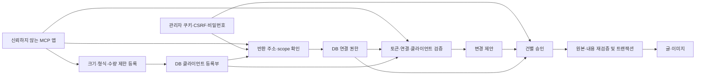

# MCP 등록·권한·승인 설계

## 결정과 범위

클라이언트 등록은 DB의 운영 데이터입니다. 환경 변수에는 서버 공개 주소와 MCP 활성화 등 배포 설정만 둡니다. 등록, OAuth 권한 동의, 글·이미지 변경 승인을 별도 단계로 처리합니다. 사용자에게 모든 앱의 ID와 콜백을 배포 설정에 입력하도록 요구하지 않습니다.

관리자 사전 등록만 지원하는 방식은 익명 등록 경로를 줄이지만 자동 등록 전용 앱과 연결할 수 없습니다. 기본 연결은 표준 동적 클라이언트 등록(DCR)을 사용하고, 앱이 사전 등록 정보를 요구할 때만 관리자 화면에서 발급합니다. DCR은 무권한 메타데이터 등록으로 제한합니다. 자체 신고 앱 이름은 검증된 신원으로 취급하지 않습니다.

별도 외부 JWT 모드는 동일한 즉시 폐기 정책을 제공하지 못하므로 제거했습니다. 외부 IdP를 다시 도입하려면 로컬 grant와 외부 폐기 상태의 일관성을 먼저 설계해야 합니다. 임의 메타데이터 URL을 가져오는 CIMD는 지원하지 않으며 기능 발견 응답에도 지원하지 않는다고 표시합니다. 이 선택은 SSRF, DNS 재바인딩, 원격 문서 갱신에 따른 콜백 신뢰 변경을 새로 도입하지 않기 위한 것입니다.

## 신뢰 경계

관리자 브라우저와 모델 실행 환경은 분리되어야 합니다. 서버는 모델이 보낸 `approved` 값이나 본문 지시를 승인으로 해석하지 않습니다. OAuth 토큰에는 관리자 승인 권한이 없으며 승인 API는 Authorization 헤더를 거절합니다. 다만 관리자 쿠키·비밀번호와 브라우저 제어권을 모델에 함께 제공하면 서버가 그 조작을 사람과 구별할 수 없습니다. 이 한계를 UI 자동화 방지 보장으로 포장하지 않습니다.

## 권한 상태와 수명

| 상태 또는 전이 | 서버가 확인하는 조건 | 결과 |
| --- | --- | --- |
| 등록 | 정확한 콜백, 지원 인증 방식, scope, 메타데이터 크기·등록 수 | 등록 ID만 생성, 콘텐츠 권한 없음 |
| OAuth 시작 | 현재 등록, 등록 scope 상한, 정확한 콜백, PKCE S256 | 10분 유효한 동의 요청 |
| 연결 동의 | 관리자 쿠키, 동일 출처, CSRF, 선택 scope, 비밀번호, 미처리 상태 | 최대 30일 grant와 60초 단회 코드 |
| 토큰 발급 | 현재 등록·인증 방식, 코드/refresh 귀속, PKCE 또는 refresh, 활성 grant | 15분 access 및 요청한 경우 최대 7일 refresh |
| 코드/refresh 재사용 | 단회 소비 조건부 갱신 실패 | 해당 grant 폐기 |
| 관리 설정 수정·비밀값 회전·등록 삭제 | 브라우저 전용 검증과 명시적 작업, 비밀번호, 최신 메타데이터 CSRF | 해당 클라이언트의 grant·미처리 동의 동시 폐기 |
| 연결 해제 | 브라우저 전용 검증과 해당 grant의 CSRF·명시적 해제 | 해당 연결만 폐기, 등록 유지 |
| 변경 제안 | 도구별 scope, 클라이언트 귀속 idempotency, 입력 검증 | DB 제안만 저장 |
| 변경 승인 | 관리자 브라우저 검증, 활성 등록·grant, 요청/원본 해시, 미처리 상태 | 변경·실행 상태·감사를 한 트랜잭션으로 저장 |

동일 idempotency key에 다른 내용을 보내면 충돌로 거절합니다. 같은 관리자 생성 폼을 재제출하면 새 ID를 만들지 않습니다. 관리 수정의 CSRF는 메타데이터 revision에 묶여 있으므로 오래된 창에서 덮어쓰기할 수 없습니다. 비밀값을 포함한 응답이 유실되면 조회로 복구하지 않고 재발급합니다.

## 동시성 및 폐기

등록·동의·관리 변경·만료 정리는 공유 DB 트랜잭션 잠금을 먼저 획득합니다. PostgreSQL에서는 advisory transaction lock, SQLite에서는 BEGIN IMMEDIATE를 사용합니다. 토큰 교환과 변경 승인은 grant 행을 잠그며, 관리 변경의 grant 폐기 SQL도 그 행 잠금과 직렬화됩니다.

설정 변경 전에 SDK가 읽어 둔 클라이언트 객체를 그대로 신뢰하지 않습니다. OAuth 동의 요청을 저장하기 직전 현재 DB 메타데이터로 콜백과 scope를 다시 확인합니다. 설정 변경은 이미 열린 동의도 폐기합니다. 폐기 완료 후 시작하는 토큰 검증·교환·변경 승인은 실패합니다. 이미 권한 검사를 통과한 읽기의 응답을 회수하거나 이미 완료한 변경을 되돌리지는 않습니다. 변경 실행이 grant 잠금을 먼저 얻었다면 해제보다 먼저 완료될 수 있습니다.

## 입력과 비밀값

콜백은 HTTPS 또는 loopback HTTP이며 최대 10개입니다. wildcard, 사용자 정보, fragment, 제어 문자, 역슬래시를 원문에서 거절합니다. URI 파서 정규화 전에 확인하여 입력 의미가 바뀌는 경우를 피합니다. 공개 클라이언트도 PKCE S256을 사용합니다. 인증 방식은 `none`과 `client_secret_post`만 광고하고 허용합니다.

access·refresh·authorization code는 SHA-256 식별자로만 저장합니다. SDK의 클라이언트 인증 비교에는 복호화 가능한 비밀값이 필요하므로 client secret은 기존 서버 키에서 도메인 분리하여 파생한 Fernet 키로 암호화합니다. 목록 API는 필드 허용 목록으로 응답하여 평문·암호문 모두 제외합니다. 감사 기록에는 작업 종류와 식별자만 기록하고 비밀번호·토큰·비밀값을 기록하지 않습니다. 키 교체와 DB/키 동시 유출의 한계는 운영 안내에 명시합니다.

## 가용성과 자원 제한

IP 제한과 별도로 동적 등록 전체 100개·콜백당 10개, 동의 전체 100개·클라이언트당 10개를 제한합니다. 클라이언트 메타데이터와 동의 파라미터는 각각 UTF-8 JSON 4 KiB 이하입니다. 수동 등록은 별도 100개 예산입니다. 사용하지 않는 동적 등록은 24시간 후 만료되며 유효한 grant 또는 진행 중인 동의가 있으면 정리가 보존합니다. 등록 상한을 채워 신규 연결을 거절시키는 가용성 공격은 남아 있습니다. 상한을 무제한으로 늘리거나 기존 연결을 퇴출하여 해결하지 않습니다.

관리 변경의 비밀번호 검증은 공유 DB 잠금을 얻기 전에 수행합니다. 등록·동의·관리 요청에만 공유 잠금을 적용하고 일반 글 읽기를 직렬화하지 않습니다. 실제 운영 처리량과 지연 시간은 측정하지 않았으며 로컬 회귀 테스트를 부하 검증으로 취급하지 않습니다.

## UX 계약

- 기본 화면은 서버 주소와 실제 연결 순서를 보여 줍니다. 수동 발급은 접힌 보조 흐름입니다.
- 등록된 앱은 요청 가능한 권한 상한을 표시하고 활성 연결은 실제 허용된 권한을 표시합니다.
- 앱 이름은 자체 신고 정보이며 동의 화면에서 실제 반환 주소와 클라이언트 ID를 함께 표시합니다.
- 수정·삭제·비밀값 재발급은 영향 범위와 재연결 필요를 표시한 확인 폼에서 진행합니다. 취소는 요청을 보내지 않습니다.
- 비밀값은 한 번만 표시하고 이후 다시 조회하지 않습니다. 오류 또는 응답 유실 시 목록에서 상태를 확인하도록 안내합니다.
- 이미지 관리는 기존 선택·일괄 작업 구성을 유지합니다. MCP를 통한 파괴적 이미지 작업은 글 변경과 같은 승인 경계를 통과합니다.

## 전환과 검증 기준

기존 글·이미지·감사·DB 동적 등록을 보존합니다. env 정적 등록은 가져오지 않고 새 ID로 재연결합니다. 환경 변수 import로 삭제한 앱이 다시 나타나지 않게 합니다. 테이블 형식은 기존 OAuth 저장소를 재사용하므로 이번 변경에 추가 migration은 없습니다. MCP를 처음 도입하는 경우 기존 MCP migration을 적용해야 합니다.

검증은 실제 SDK HTTP 경로의 DCR→PKCE→동의→토큰→MCP, 잘못된 callback·scope·CSRF·출처·비밀번호, 비밀값 비노출, 코드·refresh·동의 재사용, 오래된 메타데이터, 관리 생성 중복, 등록 한도·만료, PostgreSQL 토큰 교환/폐기와 승인 경합, 기존 글·이미지 회귀를 포함합니다. 프론트엔드 빌드·정적 검사와 실제 브라우저 등록·취소·삭제 검증은 구분합니다. 운영 Cloudflare와 실제 ChatGPT/Claude 계정 연결은 별도 확인이 필요합니다.

참고: [MCP Authorization](https://modelcontextprotocol.io/specification/2025-11-25/basic/authorization), [RFC 7591](https://www.rfc-editor.org/rfc/rfc7591), [MCP Python SDK](https://github.com/modelcontextprotocol/python-sdk).
